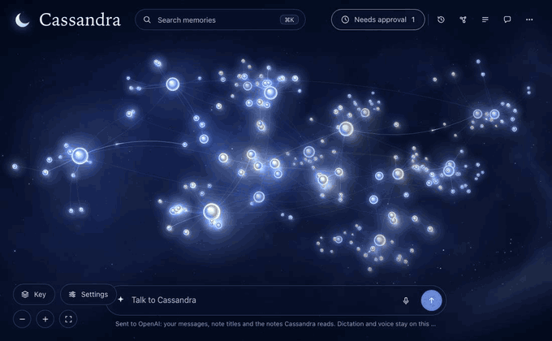
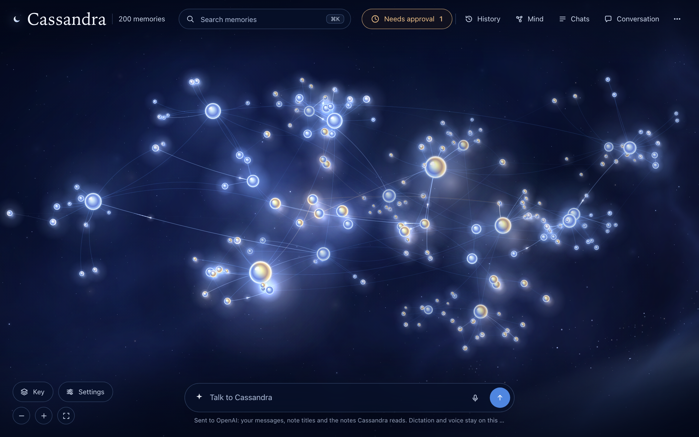
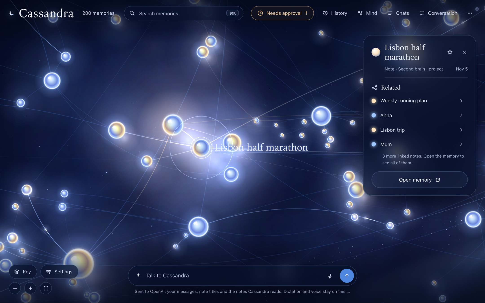
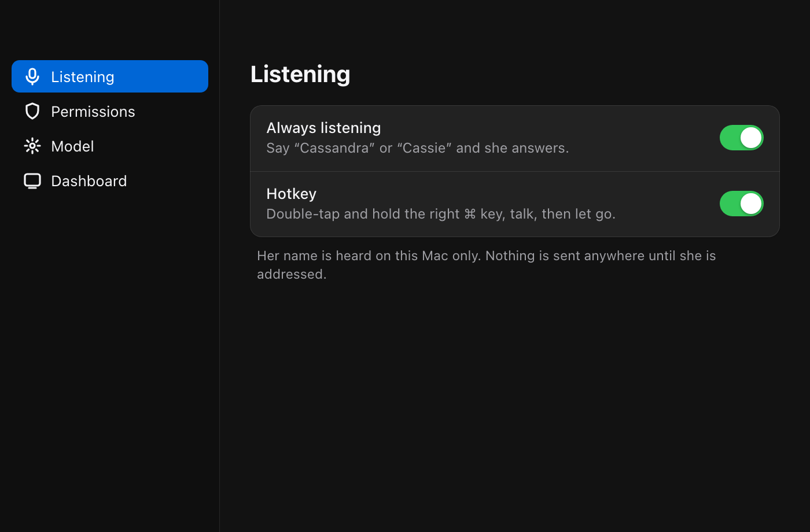
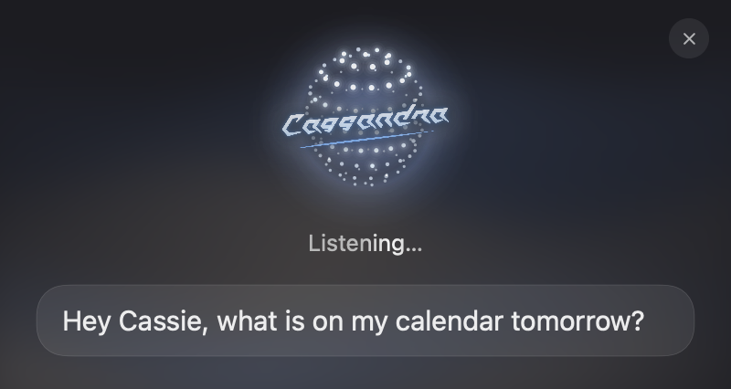
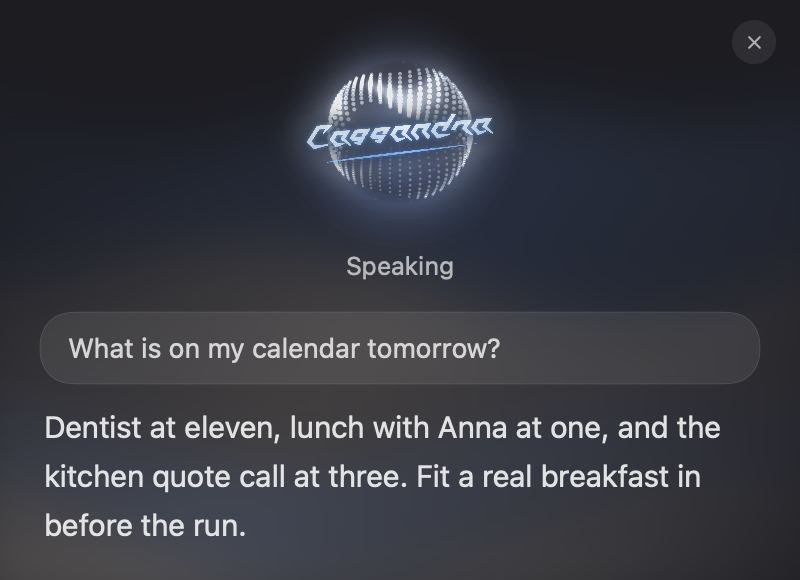
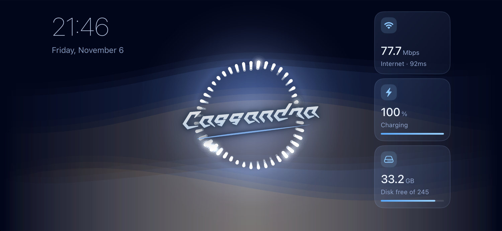
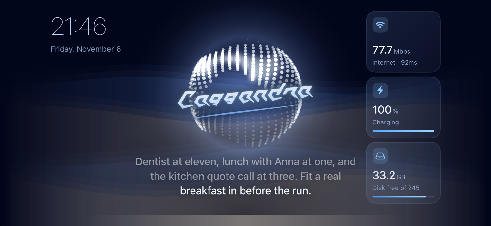

# Project Cassandra

### Your second brain, alive.

A voice-first personal AI companion for your Mac. She remembers what you tell her, finds what you need instantly, 
and talks to you like she actually knows you. Everything she knows stays as files you own, on your Mac.

[Highlights](#highlights) &nbsp;·&nbsp; [A closer look](#a-closer-look) &nbsp;·&nbsp; [What she can do](#what-she-can-do) &nbsp;·&nbsp; [Privacy and safety](#privacy-and-safety) &nbsp;·&nbsp; [Using Cassandra](#using-cassandra) &nbsp;·&nbsp; [Questions](#questions)

https://github.com/user-attachments/assets/REPLACE-WITH-YOUR-VIDEO-ID

> [!NOTE]
> **Project Cassandra is under development and closed source.** This page shows what it does. The app will be published soon.

 

Cassandra (Cassie for short) lives in your menu bar. Say her name, or double-tap and hold the right ⌘ key, and talk. She listens, thinks and answers out loud, while a small card at the top right of your screen, the **Cassie deck**, shows your words as you speak and writes her answer as she says it.

## Highlights

<table>
  <tr>
    <td width="33%" valign="top"><b>🎙&nbsp; Voice, on your Mac</b> Say "Cassandra", or hold the right ⌘ key. Your speech is turned into text and spoken back on your Mac. Interrupt her any time.</td>
    <td width="33%" valign="top"><b>🌌&nbsp; Your memory, drawn as a galaxy</b> Your second brain is your own notes and memories. The galaxy is a beautiful way to see them: each star is one memory, and related ones sit together.</td>
    <td width="33%" valign="top"><b>🪟&nbsp; The Cassie deck</b> A card at the top right shows your words live and her answer as she speaks, a few lines at a time like a teleprompter.</td>
  </tr>
  <tr>
    <td valign="top"><b>📱&nbsp; An old iPhone as her display</b> An optional iPhone app shows her orb, the time, internet speed, battery and disk, and her reply as a caption.</td>
    <td valign="top"><b>🧠&nbsp; She learns who you are</b> Tell her once, "keep answers short" or "call me boss", and she keeps it. You can see what she remembers about you and undo it.</td>
    <td valign="top"><b>🔒&nbsp; Honest and private</b> Your memories are plain files you own. She never invents a memory or an action, and anything risky asks you first.</td>
  </tr>
  <tr>
    <td valign="top"><b>🖐&nbsp; She works your Mac</b> Opens and moves windows, clicks and types in other apps, drives your browser, plays Spotify and more. Anything risky asks you first on a card.</td>
    <td valign="top"><b>⚡&nbsp; Instant commands</b> "Open Notes", "Chrome on the left" and "scroll down" are done in a blink, in her voice.</td>
    <td valign="top"><b>🔁&nbsp; She learns your routines</b> Do something once and the same words later repeat it. "When I say work mode, open Mail and Notes" teaches her a name.</td>
  </tr>
</table>

## A closer look

**Your memory, as a galaxy**

This is how you see your memory. Every star is one note or fact she keeps, and the lines join related ones.

 

<table>
  <tr>
    <td align="center"> <b>A memory</b> what it links to, edit in place</td>
    <td align="center"> <b>Settings</b> a real Mac window with a sidebar</td>
  </tr>
</table>

**The Cassie deck**: listening, then speaking

<table>
  <tr>
    <td valign="top" align="center"> <b>Listening</b> your words appear as you speak</td>
    <td valign="top" align="center"> <b>Speaking</b> her answer is written as she says it</td>
  </tr>
</table>

**The iPhone hub**

<table>
  <tr>
    <td align="center"> <b>At rest</b> orb, time, internet, battery, disk</td>
    <td align="center"> <b>While she speaks</b> her reply as a caption</td>
  </tr>
</table>

The screenshots use a made-up sample set of notes, not real ones.

 

## What she can do

### Your memory, drawn as a galaxy

What she knows about you is your memory: your notes, and the facts and preferences she learns, kept as plain files on your Mac. The galaxy is just a beautiful way to look at them. Every star is one memory, and related ones drift into constellations, with the most connected ideas glowing brightest. Click a star to read it, see what it links to and edit it in place, or press `⌘K` to search. When she answers, she flies to the memories she used.

### Voice, entirely on your Mac

- **Say "Cassandra" or "Cassie"**, or **double-tap and hold the right ⌘ key** from anywhere and let go when you're done.
- Your speech is turned into text and spoken back on your Mac. Nothing is sent anywhere until she's addressed, and then only the text of what you said goes to the AI.
- **Interrupt her** whenever you like. She remembers what she had and hadn't said, and finishes only if you still need it.
- **End a conversation** by saying "that's all", "thanks", "goodbye" or "stop listening", or press `Esc`.
- **Chats by voice:** "new chat", "switch to the one about my passport", "list my chats".

### She learns who you are

Tell her "keep your answers short" or "call me boss" once, and she keeps it. Instructions, preferences and facts become part of her own memory, separate from your notes and visible any time. Forget or restore anything.

### She works your Mac

Everything here is spoken, with no buttons.

- **Windows and apps.** Open, quit and move apps by name, even when misheard ("Chrome on my big screen", "Terminal on the left and Code on the right"). She checks every move and reports it, never assumes.
- **Other apps' controls.** She can click, type, press keys, scroll, drag and use menus in other apps, including the menu-bar icons at the top right (Wi-Fi, Bluetooth, battery). She can type at your text cursor, and rewrite or insert text into the field you were in.
- **Your browser.** Search the web, read a page, and click or fill in a page in your own tab, without moving your mouse or stealing focus.
- **The screen.** "Explain this" uses what you've selected. "Where do I click?" draws boxes, arrows and labels on your screen, one step at a time, or lights a ring on the spot. "Explain it and draw it" builds a diagram with math. You can mark something on screen yourself and ask about it.
- **Spotify.** Play your playlists, songs, albums or artists, and add a song to the queue.
- **People and you.** She looks people up in Contacts ("my brother") and keeps short facts about you, like contact details, places and preferences, to fill in forms. You can import your own card from Contacts and Mail, and forget any of it.
- **Time.** Add, move and delete calendar events (existing ones always ask first), and set reminders. Routines ("every weekday at 9, tell me my day") and watches ("tell me when the build finishes") run on their own.
- **Commands and settings.** She can run a command for you, change her own settings by voice ("turn off drawings"), and look back at what you asked before.

### Instant commands

A sentence that is just "open X", "close X", "put X on the left", "search for X", "play X", "scroll down" or "press escape" is done at once, in her voice ("Done, boss.").

### She learns your routines

When she does something right, the steps are saved, and the same words later repeat them. "When I say work mode, open Mail and Notes" teaches her a name. Say "no, I meant …" and she unlearns the wrong one.

### An old iPhone as her display

An old iPhone on a shelf becomes Cassandra's always-on screen. It shows her orb, the time, your Mac's internet speed, battery and free disk, and **her reply as a caption**, in step with her voice. If your Mac or Cassandra stops, the whole screen turns grey. It only displays: the phone doesn't listen.

### And more

- **Reads your Apple Notes** (read-only), and can create real calendar events and reminders when you ask.
- **Sees your screens** when you ask ("what's on my screen?"), across multiple displays.
- **Notices the moment:** she knows your Mac's battery, what's on your calendar in the next day and how long it's been since you last spoke, and may remark on it in her own voice, or say nothing.
- **Her personality is one plain-text file** you can rewrite however you like.

## Privacy and safety

- **An Allow card** appears before anything that sends, deletes, buys, confirms, changes a file or runs another program. No answer in a minute means No.
- **Some things are always blocked.** She can't run deleting, shutdown or other dangerous commands.
- **Passwords:** she types into a password field only if you asked for exactly that.
- **Safe mode** is on by default. She can turn it on by voice, never off.
- **Your words only:** she saves facts about you only from what you said in the chat, and never anything sensitive such as cards, passwords, health or money.
- **Your files, your Mac.** Your memories are plain files that stay on your Mac. Only the text of what you say, and the notes she reads to answer, go to the AI service you choose.

## Using Cassandra

| You want to | Do this |
|---|---|
| Start talking | Say "Cassandra" or "Cassie", or double-tap and hold the right ⌘ key |
| Stop her mid-sentence | Just talk over her |
| End the conversation | Say "that's all" or "goodbye", or press `Esc` |
| See your memory | Say "show me your dashboard" to open the galaxy of your notes |
| Start or switch chats | "New chat", "switch to the one about …", "list my chats" |
| Open or arrange windows | "Open Notes", "Chrome on the left and Terminal on the right" |
| Set a routine | "Every weekday at 9, tell me my calendar" |

## Good to know

- **You'll need** a Mac, a microphone, and your own account with an AI service.
- **Coming later.** Background helpers, meeting notes and dictating text into any app are planned, not built yet.

## Questions

**Is it released?**
Not yet. Project Cassandra is under development and closed source. It will be published soon.

**Does everything go to the cloud?**
No. Voice and your memories stay on your Mac. Only the text of what you say to her, and the notes she reads to answer, go to the AI service you choose.

**Can she do things without asking?**
Only safe, everyday things such as opening an app. Anything that sends, deletes, buys, changes a file or runs a program asks first.

**Is the galaxy the app?**
No. The galaxy is a picture of your memory, the notes and facts she keeps about you. She is a voice assistant that lives in your menu bar, and the galaxy is the dashboard where you can see and edit what she remembers.

**Do I need the iPhone?**
No. The iPhone display is optional.

 

Developed by Chetan Singh

